<a href="https://jithendravarma.com">
  
</a>

<div align="center">


<br/>

<a href="https://jithendravarma.com"></a>
<a href="https://www.linkedin.com/in/jithendravarma/"></a>
<a href="https://adelaistudio.com.au"></a>
<a href="https://tastibase.com"></a>
<a href="https://orcid.org/0000-0001-9467-5612"></a>
<a href="https://scholar.google.com/citations?user=dc60UHYAAAAJ"></a>
<a href="mailto:jithendra9367@gmail.com"></a>

</div>

<br/>

```python
class Jithendra:
    role       = "Digital Solutions & Systems Specialist @ Treasury Wine Estates"
    based_in   = "Barossa Valley · Adelaide, South Australia"
    founder_of = ["Adel AI Studio", "Tastibase"]
    education  = "Master of Data Science, University of Adelaide"
    focus      = ["AI in operations", "automation", "real-time dashboards", "NLP"]
    principle  = "Start on the floor. Build something simple people trust."

    def now(self):
        return "Bringing AI, automation and live data to the winery & packaging floor 🍷"
```

## ◆ Now

> I build the systems that turn messy data and manual work into clear, fast decisions, using AI, automation and dashboards that people actually use.

- **Treasury Wine Estates** (home of Penfolds, Wolf Blass, Wynns, Pepperjack): leading practical AI adoption across Supply, prototyping AI use cases on the floor, building real-time Power BI dashboards, and digitising manual processes with Power Apps, Power Automate, Python and SQL.
- **Adel AI Studio**: a day on site, then within a week a proposal, an hours-saved estimate and a working demo. Websites, SEO and Claude coaching days for Adelaide teams.
- **Tastibase**: the IMDb for food. Ranking individual dishes, not restaurants, from real reviews.

## ◆ Featured Work

<table>
<tr>
<td width="50%" valign="top">

### 🍛 [Tastibase](https://tastibase.com)
**AI dish rankings from customer reviews**

44,000+ reviews → **711 dishes** across **486 restaurants**. Fine-tuned BERT beat VADER (**85% vs 50%**), blended with star ratings through a Bayesian-shrinkage score. ~1,250 pre-rendered pages with programmatic SEO.

`Python` `pandas` `scikit-learn` `Transformers` `BERT` `Next.js` `Cloudflare Pages`

</td>
<td width="50%" valign="top">

### 🤖 [Adel AI Studio](https://adelaistudio.com.au)
**AI automation, websites & SEO for Adelaide**

Shipped for [Meridian Vocational College](https://mvc.edu.au) (custom WordPress theme + online document control), Adelaide Culinary Institute, Adelaide Construction Institute, [Aim Care Services](https://aimcareservices.com.au), [RealVR](https://www.realvr.com.au) and [RightLaserCut](https://www.rightlasercut.com.au).

`Claude` `AI workflows` `WordPress` `Cloudflare` `SEO` `Analytics`

</td>
</tr>
<tr>
<td width="50%" valign="top">

### 🦴 [Knee Osteoarthritis Prediction](https://pesjournal.net/journal/v5-n3/11.pdf)
**Published · Proceedings on Engineering Sciences, 2023**

VGG16 CNN grading knee X-rays into the five Kellgren-Lawrence categories with **95%+ accuracy**. DOI [10.24874/PES05.03.011](https://doi.org/10.24874/PES05.03.011) · 20 citations.

`Deep Learning` `VGG16` `Medical Imaging` `Python`

</td>
<td width="50%" valign="top">

### 🏴‍☠️ Heroes & Villains in *Treasure Island*
**End-to-end NLP · University of Adelaide**

spaCy NER + alias mapping (149 mentions → 22 characters), quote attribution and dependency-based sentiment, then a 2D sentiment × volatility role framework with KDE thresholds.

`spaCy` `NLP` `Sentiment Analysis` `KDE`

</td>
</tr>
<tr>
<td width="50%" valign="top">

### 🚗 Accident-Prone Zones in Australia
**Clustering · University of Adelaide**

2019–2022 crash data across NSW, VIC, QLD, SA, WA. K-Means risk zones validated with elbow/silhouette, then Random Forest, SVM and Gradient Boosting to confirm separability.

`K-Means` `Gradient Boosting` `scikit-learn`

</td>
<td width="50%" valign="top">

### 📦 Cost-Efficient Packaging Collection
**Logistics optimisation**

Pickups grouped by pincode with dispatch thresholds, routes planned with Google Maps APIs, and the Travelling Salesman Problem solved with Google OR-Tools. Piloted.

`OR-Tools` `Google Maps APIs` `Optimisation`

</td>
</tr>
</table>

<details>
<summary><b>More projects</b></summary>
<br/>

| Project | What it does | Note |
| --- | --- | --- |
| **Intelligent Delivery System (NFC)** | Returnable NFC packaging that stores order and return details, with loyalty points for returns | 🥈 2nd place, IPR Expo 2022 |
| **Homegrowns** | E-commerce platform removing middlemen for farmers ("Mangood" for mango growers) | Published, JETIR Vol. 9 Issue 6 (2022) |
| **SafeguardHER** | Bluetooth beacons pushing safety info and emergency help to women on public transport | Pitched at Returning Mothers Conference 2022, KIIT |
| **Are the People of the Mahābhārata Real?** | Pre-registered record-linkage test against the Vedic corpus | Dataset, [Zenodo](https://doi.org/10.5281/zenodo.23875711) (2026) |

</details>

## ◆ Toolkit

<table>
<tr><td><b>AI & ML</b></td><td>


</td></tr>
<tr><td><b>Data & BI</b></td><td>


</td></tr>
<tr><td><b>Automation</b></td><td>


</td></tr>
<tr><td><b>Web & Cloud</b></td><td>


</td></tr>
<tr><td><b>Business analysis</b></td><td>Requirements · process mapping · user stories · UAT · SOPs · gap analysis · document control</td></tr>
</table>

## ◆ Experience

| When | Role | Where |
| --- | --- | --- |
| Nov 2026 – now | **Digital Solutions & Systems Specialist** | Treasury Wine Estates · Barossa Valley |
| Jun 2026 – now | **Founder & Data Scientist** | [Tastibase](https://tastibase.com) |
| Nov 2025 – now | **Founder & AI Automation Consultant** | [Adel AI Studio](https://adelaistudio.com.au) |
| Sep – Nov 2026 | ICT Business Analyst (AI Transformation) | Adelaide Culinary Institute |
| Aug – Oct 2026 | Database Administrator (Internship) | Adelaide Culinary Institute |
| Oct 2025 – Apr 2026 | Digital Business Analyst (Web & Marketing Systems) | RightLaserCut |
| Apr 2024 – Sep 2025 | Web & Digital Operations Coordinator | RightLaserCut |
| Nov 2023 – Mar 2024 | Operations & Digital Support | RightLaserCut |
| Apr 2021 – Aug 2023 | Founder & Tech Writer | FutureTechIdeas |
| Feb – Jun 2023 | Programmer Analyst Trainee | Cognizant · Hyderabad |

<details>
<summary><b>Other roles</b></summary>
<br/>

| When | Role | Where |
| --- | --- | --- |
| Jan 2026 – now | Fresh Convenience Team Member | Woolworths · Golden Grove |
| Feb – Aug 2026 | Retail Merchandiser | CROSSMARK Australia |
| Nov 2023 – Apr 2026 | Science Mentor & Support Worker | Private |
| Nov 2023 – Jan 2026 | Online Personal Shopper | Woolworths · Tea Tree Gully |

</details>

## ◆ Education & Credentials

| | |
| --- | --- |
| 🎓 **Master of Data Science** | University of Adelaide · 2023 – 2025 |
| 🧭 **Professional Year, Information Technology** | Performance Education · 2025 – 2026 |
| ⚡ **B.Tech, Electronics & Communication Engineering** | Sree Vidyanikethan Engineering College (JNTUA) · 2019 – 2023 |

<details>
<summary><b>Certifications</b></summary>
<br/>

- The Complete Oracle SQL Certification Course · Cognizant (2023)
- Data Security · Cognizant (2023)
- Programming, Data Structures and Algorithms Using Python · NPTEL (2022)
- Python for Everybody Specialization · University of Michigan (2022)
- MTA: Introduction to Programming Using Python · Microsoft (2022)
- AWS Academy Graduate: Cloud Foundations · AWS (2021)
- The Fundamentals of Digital Marketing · Google Digital Garage (2021)

</details>

## ◆ GitHub

<div align="center">
  
  
  <br/>
  
</div>

<br/>

<div align="center">

**Open to conversations about AI in operations, data, automation — or wine.**

<a href="https://www.linkedin.com/in/jithendravarma/"><b>Connect on LinkedIn</b></a> · <a href="https://jithendravarma.com"><b>jithendravarma.com</b></a> · <a href="mailto:jithendra9367@gmail.com"><b>jithendra9367@gmail.com</b></a>

</div>


